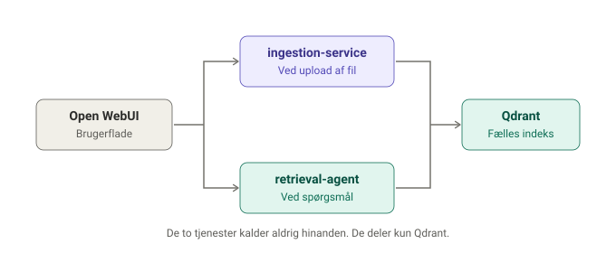
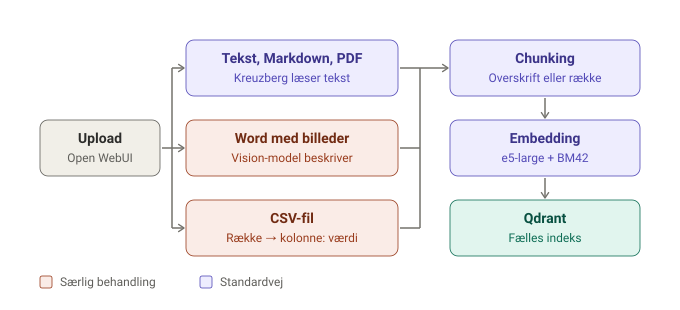
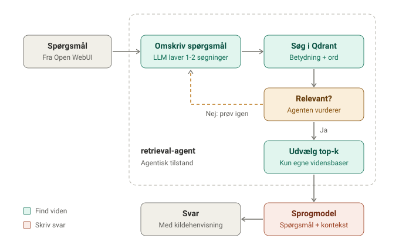

# Sådan virker RAG i AarhusAI

Denne side forklarer, hvordan AarhusAI finder viden i jeres dokumenter og bruger
den til at svare. Man følger hele vejen fra et dokument lægges i en vidensbase,
til brugeren stiller et spørgsmål og får et svar med kilder.

## Hvad er RAG?

RAG står for Retrieval-Augmented Generation. Sprogmodellen kender ikke jeres
interne viden på forhånd. I stedet søger systemet i vidensbasen, hver gang
brugeren spørger (afhænger af systemprompt hvornår det vurdere at der skal søges i viden),
og giver de mest relevante tekststykker med til sprogmodellen,
som så skriver svaret ud fra dem.

En god måde at forklare det på: sprogmodellen er en dygtig skribent uden adgang
til jeres arkiv. RAG er bibliotekaren, der finder de mest relevante sider i
arkivet og lægger dem på skrivebordet, før skribenten svarer.

RAG består af to faser:

1. **Ingestion**: Dokumenterne gøres søgbare. Det sker, når en fil lægges i en
   vidensbase, og igen når den opdateres.
2. **Retrieval og svar**: Der søges i den indekserede viden, og sprogmodellen
   svarer. Det sker, hver gang en bruger stiller et spørgsmål.

## Arkitektur

I AarhusAI er RAG flyttet ud af Open WebUI og ind i to separate tjenester.
`ingestion-service` gør dokumenterne søgbare, og `retrieval-agent` søger i dem.
De to tjenester kalder aldrig hinanden. Det eneste, de deler, er indekset i
Qdrant.



Fordi de to tjenester kun deler Qdrant, skal de bruge præcis den samme
embedding-model. Bruger de forskellige modeller, bliver søgeresultaterne
forkerte, uden at der kommer en fejlmeddelelse.

## Fase 1: Ingestion

Når en fil lægges i en vidensbase, gemmer Open WebUI den rå fil i S3 og beder
`ingestion-service` om at behandle den. Tjenesten vælger først en vej ud fra
filtypen og indholdet, og derefter bliver alt chunket, embedded og gemt på samme
måde.



### Udtræk af tekst

De fleste filer, herunder Markdown, går standardvejen gennem Kreuzberg.
Kreuzberg læser teksten, henter metadata som titel og sprog og gengiver
indlejrede tabeller som Markdown. Markdown er den nemmeste filtype, fordi den
allerede er ren tekst.

### Word-filer med billeder og diagrammer

En almindelig tekstudtrækker smider billeder væk. Derfor sender tjenesten
Word-filer med flowcharts eller store billeder til en vision-model, der
beskriver indholdet. Små billeder som ikoner og logoer i sidehoved og sidefod
bliver ikke medregnet. Resultatet er den originale tekst fra dokumentet plus en
beskrivelse af diagrammet, så det kan søges i som alt andet.

### CSV-filer

Et almindeligt chunk midt i et regneark mister kolonneoverskrifterne. CSV-filer
har derfor deres egen vej, hvor hver række skrives som linjer med
`kolonne: værdi`. Rækken `Anne, 8000, Aarhus` bliver altså til `Navn: Anne`,
`Postnr: 8000` og `By: Aarhus`. Hver række havner i præcis ét tekststykke.

### PDF-filer med billeder

PDF-filer går altid standardvejen gennem Kreuzberg. Teksten bliver læst, men
billeder, diagrammer og screenshots i en PDF bliver ikke beskrevet. Står der
vigtig information i et billede, kan søgningen ikke finde den. Indscannede
PDF-filer uden tekstlag kan kun læses, hvis Kreuzberg kører med OCR.

> **Tommelfingerregel:** Hvis en vigtig pointe kun findes i et billede i en PDF,
> så skriv den også som tekst, eller læg dokumentet ind som Word eller Markdown
> i stedet.

### Chunking

Teksten deles i mindre stykker, så sprogmodellen kun får de relevante dele og
ikke hele dokumenter. Markdown-chunkeren deler først efter overskrifter og
pakker derefter hver sektion i stykker på op til cirka 400 tokens med 80 tokens
overlap. Meget små sektioner lægges sammen med naboerne.

Hvert stykke husker sin overskriftssti, for eksempel
`Personalehåndbog > Ferie > Overførsel`. Stien sættes foran teksten, når den
embeddes, så overskrifterne er med til at bestemme, hvad stykket bliver fundet
på.

### Lagring i Qdrant(vektordatabase)

Alle stykker gemmes i én fælles samling i Qdrant. Hvert stykke er mærket med den
vidensbase, det tilhører, så en assistent kun kan finde viden fra de
vidensbaser, den er koblet til.

Når et dokument opdateres, skrives den nye version, før den gamle slettes.
Fejler noget undervejs, bliver den tidligere version stående, så brugerne aldrig
ser et halvt opdateret dokument.

## Fase 2: Retrieval og svar

Når brugeren stiller et spørgsmål, sendes det fra Open WebUI til
`retrieval-agent`.

### Agentisk tilstand

I agentisk tilstand omformulerer en sprogmodel spørgsmålet til bedre søgninger
og vurderer resultaterne. Er de helt ved siden af, prøver den igen med en ny
formulering.



Agenten laver normalt 1 til 2 søgninger og accepterer resultatet, hvis blot ét
af de fundne stykker er relevant. Der er et loft over antallet af forsøg, så den
ikke kan blive ved. Brugerens oprindelige spørgsmål bliver altid søgt med, så
svaret aldrig alene afhænger af omformuleringerne.

Agentisk tilstand giver bedre svar på vage eller sammensatte spørgsmål, men
koster cirka 2 til 5 gange så lang svartid og 2 til 4 gange så mange tokens pr.
spørgsmål.

### Svaret

Sprogmodellen får spørgsmålet og de udvalgte stykker og skriver svaret ud fra
dem. Svaret vises i Open WebUI med henvisning til de dokumenter, det bygger på.

## Struktur og hierarki i dokumenter

Der er tre former for hierarki, og de har meget forskellig betydning for
søgningen.

**Overskrifter i dokumentet betyder mest.** Overskriftsstien bliver en del af
hvert stykkes fingeraftryk. Brug beskrivende overskrifter frem for generiske som
"Generelt", "Øvrigt" eller "Bemærk". To til tre niveauer er fint. Dybere
hierarkier hjælper sjældent, fordi stien optager plads i hvert stykke.

**Opdeling i vidensbaser har også effekt.** Søgningen filtrerer på vidensbase.
Når en assistent kun er koblet på relevante vidensbaser, er der færre forkerte
kandidater at vælge imellem.

**Mappestruktur betyder stort set intet.** Søgningen kigger på indholdet af
tekststykkerne, ikke på hvor filen lå. Skal konteksten med, skal den stå i
dokumentets titel og overskrifter.

Skriv hver sektion, så den giver mening alene. Sprogmodellen ser kun de udvalgte
stykker, så henvisninger som "som nævnt ovenfor" peger ud i det blå.

## Gode råd

### Til dem, der skriver dokumenter

- **Skriv med brugernes ord.** Forkortelser og interne kaldenavne er svære for
  søgningen. Skriv både "MUS" og "medarbejderudviklingssamtale" mindst én gang,
  gerne i en overskrift.
- **Brug spørgsmål og svar.** En overskrift som "Kan jeg overføre ferie til
  næste år?" ligger tæt på det, brugerne skriver.
- **Undgå dubletter og gamle versioner.** Ligger der to versioner af samme
  regel, kan sprogmodellen ikke vide, hvilken der gælder. Skriv gerne en dato
  eller "gældende fra" i dokumentet.
- **Erstat filer i stedet for at uploade nye.** Så skiftes den gamle version ud
  uden at efterlade rester.
- **Skriv tal og tabeller som tekst.** Små tabeller i Markdown fungerer fint.
  Store datasæt bør være CSV.
- **Skriv diagrammer som tekst.** I Markdown kan et diagram skrives som Mermaid,
  så indholdet kan søges i.

### Til dem, der bygger assistenter

- **Kobl kun relevante vidensbaser på.** Mere viden giver ikke bedre svar, men
  flere forkerte kandidater.
- **Lav et testsæt.** Saml 10 til 20 rigtige spørgsmål, nogle med svar i
  vidensbasen og nogle bevidst uden. Kør dem igen, når dokumenter eller
  indstillinger ændres.
- **Vælg søgetilstand bevidst.** Lineær er nok til klart afgrænsede spørgsmål.
  Agentisk kan betale sig, når spørgsmålene er vage.
- **Afgræns assistenten i systemprompten.** Bed den om kun at bruge vidensbasen
  og om at sige det ærligt, når svaret ikke findes.

### Til fejlsøgning

Når assistenten svarer forkert, så find ud af, om fejlen ligger i søgningen
eller i svaret:

- **Søgningen fandt ikke det rigtige stykke.** Så er det et problem med
  dokumentet eller chunkingen.
- **Søgningen fandt det rigtige stykke, men svaret er forkert.** Så er det et
  problem med prompten eller modellen.

Kildehenvisningerne i svaret er det hurtigste sted at se forskellen.
`ingestion-service` har desuden et endpoint, der kun kører udtrækket og viser,
hvordan et dokument bliver læst, og et inspektions-endpoint, der viser, hvordan
et dokument blev delt op. Inspektions-endpointet er slået fra som standard.

## Eksempel: Systemprompt til en assistent uden internetadgang

```text
Du er en hjælpsom assistent, der besvarer spørgsmål ud fra din vidensbase.
Du svarer altid på dansk i et venligt og letforståeligt sprog.

Du har ikke adgang til internettet. Din eneste kilde er den vidensbase, du
er koblet til. Brug kun de oplysninger, der står i uddragene fra
vidensbasen, når du svarer.

Hvis svaret ikke fremgår af vidensbasen, skal du sige det ærligt, for
eksempel: "Det kan jeg ikke finde i min vidensbase." Du må ikke gætte eller
supplere med viden, du selv tror at have. Hvis uddragene kun delvist
besvarer spørgsmålet, så svar på den del, du kan, og sig tydeligt, hvad du
ikke har oplysninger om.

Henvis til kilden, når du bruger oplysninger fra vidensbasen.

Hold svarene korte og præcise. Hvis spørgsmålet er uklart, så stil ét
opklarende spørgsmål i stedet for at gætte.
```

Test afgrænsningen ved at spørge om noget, som sprogmodellen sandsynligvis
kender i forvejen, men som ikke står i vidensbasen. Svarer assistenten
alligevel, bruger den sin egen viden, og systemprompten skal strammes.

## Opsummering

Kvaliteten af RAG afhænger mere af dokumenterne end af teknikken. Et velskrevet
dokument med klare overskrifter og ét emne pr. afsnit slår næsten enhver
indstilling i pipelinen.
